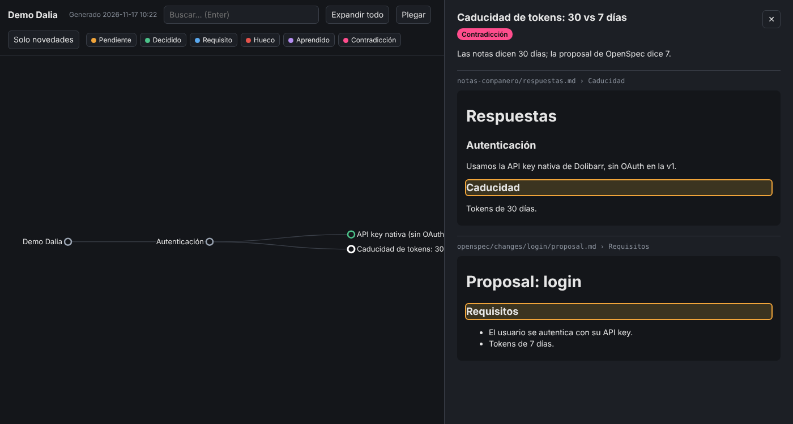

# mapa-proyecto

Skill para [Claude Code](https://claude.com/claude-code) que convierte los `.md` dispersos de un proyecto en un **mapa mental interactivo** (`mapa.html`) para saber dónde está cada cosa.



## El problema

En proyectos con mucha documentación aparecen dudas, respuestas de la IA, notas de un compañero y specs (OpenSpec u otras), repartidas en varias carpetas. Llega un momento en que no sabes dónde buscar algo, qué se decidió ni qué sigue abierto.

## Qué hace

- Recorre todos los `.md` del proyecto, en cualquier carpeta.
- Claude los clasifica por **tema funcional** y por estado: pendiente, decidido, requisito, hueco, aprendido o contradicción.
- Genera un `mapa.html` autocontenido que se abre con doble clic:
  - árbol plegable con zoom y buscador;
  - filtros por estado;
  - al hacer clic en un punto, el `.md` de origen ya renderizado, con la sección concreta resaltada;
  - marca **NUEVO** los puntos que han cambiado desde el mapa anterior (punto nuevo, cambio de estado o resumen, o cambio en la sección que cita), con el filtro "Solo novedades".
- Las siguientes pasadas son incrementales: solo vuelve a leer los ficheros nuevos o modificados.
- Si el proyecto usa OpenSpec, aprovecha su estructura, pero no lo necesita.

## Instalación

```bash
git clone https://github.com/cmaciasg/mapa-proyecto ~/.claude/skills/mapa-proyecto
```

Abre una sesión nueva de Claude Code. Para tenerla solo en un proyecto, clónala en `<proyecto>/.claude/skills/mapa-proyecto`.

Requisitos: Python 3.8 o superior. El HTML carga d3 y marked desde jsDelivr, así que para verlo necesitas conexión.

## Uso

Dentro del proyecto, pídele a Claude:

- "Hazme el mapa del proyecto"
- "Actualiza el mapa"

Para excluir carpetas, crea un `.mapignore` en la raíz con patrones glob, uno por línea:

```
legacy/*
docs/old
```

El proyecto queda con `mapa.html` y `.mapa/` (estado interno). Añádelos a tu `.gitignore` si no quieres versionarlos.

## Probar sin Claude

En `examples/` hay un proyecto de ejemplo con datos ya clasificados:

```bash
python3 scripts/mapa.py build examples/demo examples/demo-datos.json
open examples/demo/mapa.html
```

## Cómo funciona

| Pieza | Responsable |
|---|---|
| Escaneo, detección de cambios (sha1) y generación del HTML | `scripts/mapa.py` (determinista) |
| Clasificación por temas y estados, y detección de contradicciones | Claude, según `SKILL.md` |

El formato intermedio (`datos.json`) está documentado en `SKILL.md`.

## Contribuir

Las contribuciones son bienvenidas. Lee [CONTRIBUTING.md](CONTRIBUTING.md).

## English

Claude Code skill that turns a project's scattered Markdown notes (questions, decisions, requirements, specs) into an interactive mind map (`mapa.html`), with each node linking to its rendered source. Install with `git clone https://github.com/cmaciasg/mapa-proyecto ~/.claude/skills/mapa-proyecto`. The prompts and UI are in Spanish; translations are welcome.

## Licencia

[MIT](LICENSE)
